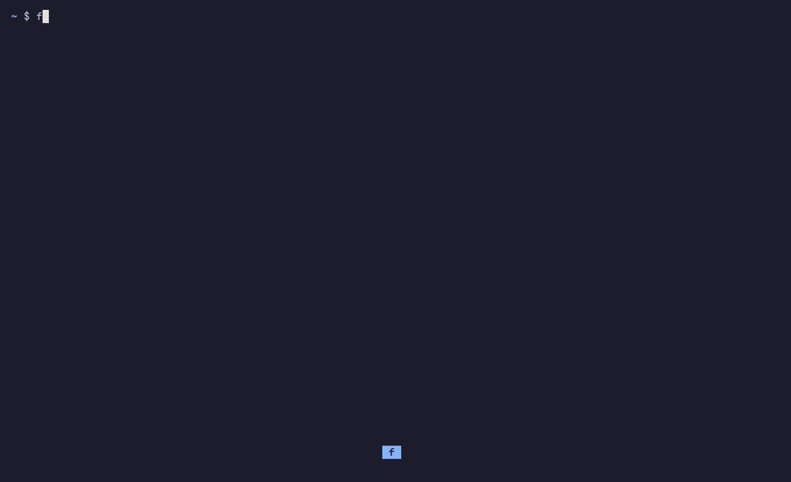

# fff — fuzzy file finder

**A terminal file manager built around a fuzzy finder.** Type a few letters
to find any file below you, however deep, then open it, act on it, or hand
it to a script. It has Vim keys throughout: every text field is a real
Neovim.


## What it does

**Finds files at any depth.** You don't have to go folder by folder: `+`
searches one level deeper, and `pdestab` finds `pde/notes/stability.tex`.
Matches are ranked the way fzf ranks them, with shallow results first.


**Searches inside files, PDFs included.** Press Tab and type: each match is
a row, with its page or line and the preview open at that spot. `L` opens
the PDF in your viewer on the page of the match.


**Works in scripts.** `fff pick` prints what you choose, and `fff` chooses
among any paths you pipe to it:

```sh
nvim "$(fff pick)"
rg -l TODO | fff | xargs -r nvim
```


**Changes files safely.** Mark files with Space, go somewhere else, and
copy or move them there. Deleting goes to a trash, and `u` undoes any
operation. Long operations run in the background with a progress bar.


**And also:**

- Three tabs, a jump list, saved [workspaces](docs/WORKSPACES.md), and a
  go-to prompt that knows your zoxide folders.
- A preview pane with syntax colors, PDF text, archive listings and media
  details. It shows text only, so it works the same in every terminal.
- 37 built-in [color palettes](docs/PALETTES.md) to switch between live, plus
  your own.
- Every key can be rebound from a searchable Keys screen (F1).
- It can be your desktop's file manager and [Firefox's file
  chooser](docs/SETUP.md#firefox-and-other-applications-file-dialogs).



## Install

fff runs on Linux and macOS. It needs [Neovim](https://neovim.io) (`nvim`
on your PATH) to run, and libarchive to build.

**Arch Linux:** build the package from this repository:

```sh
git clone https://github.com/Frankwii/fff && cd fff/packaging/aur
makepkg -si
```

**Anywhere else, with Cargo:** the crate is called `fuzzy-file-finder`
and installs the `fff` command.

```sh
cargo install fuzzy-file-finder
```

On Debian and Ubuntu, building needs `libarchive-dev`; macOS already has
libarchive.

Some features use optional programs: poppler (PDF previews and search),
DjVuLibre (DjVu search), FFmpeg (audio and video details), zoxide (folder
suggestions) and a [Nerd Font](https://www.nerdfonts.com) (file icons).
`fff setup` tells you which of these you already have.

## Quick start

```sh
fff setup                            # check what's installed, write a first configuration
eval "$(fff setup --init zsh)"       # in ~/.zshrc, so leaving fff can change your directory
fff                                  # start browsing
```

| Key | Does |
| --- | --- |
| `j` `k` | Move down and up |
| `l` `h` | Go into a folder, go up to its parent |
| `i` | Type to filter (Escape twice to come back) |
| `+` `-` | Search deeper, shallower |
| Enter | Open the highlighted file and leave fff |
| `!` / `q` | Leave fff in the folder you're in / where you started |
| F1 | Every key, searchable and rebindable |

The [tutorial](docs/GETTING_STARTED.md) walks through your first session in
about fifteen minutes.

## Documentation

**Learning fff**

- [Getting started](docs/GETTING_STARTED.md): a first session, step by step.
- [Browsing](docs/BROWSING.md): moving around, tabs, the preview, the mouse.
- [Finding files](docs/SEARCHING.md): the query, depth, filters, exclusions,
  sorting and contents search.
- [The programs](docs/PROGRAMS.md): `fff`, `fff pick`, `fff seek`, piping
  paths in, and using fff in scripts.
- [File operations](docs/OPERATIONS.md): marks, copying and moving, the
  trash, undo, renaming and archives.

**Making it yours**

- [Keys](docs/KEYS.md): modes, contexts, the Keys screen and `keys.toml`.
- [Opening files](docs/OPENERS.md): which program opens what, and the
  arguments it gets.
- [Workspaces](docs/WORKSPACES.md): saved places and setups.
- [Color palettes](docs/PALETTES.md): built-in palettes and your own.
- [Configuration](docs/CONFIGURATION.md): every setting in `config.toml`.
- [Setup and integration](docs/SETUP.md): changing directory on exit,
  completions, man pages, the desktop and Firefox.

The [changelog](CHANGELOG.md) lists what changed in each release. If you
want to work on fff itself, start with the [development
notes](docs/dev/DEVELOPMENT.md).

## License

fff is licensed under the [GNU General Public License, version 3](LICENSE)
(`GPL-3.0-only`). Palette credits are in
[THIRD_PARTY_NOTICES.md](docs/THIRD_PARTY_NOTICES.md).
