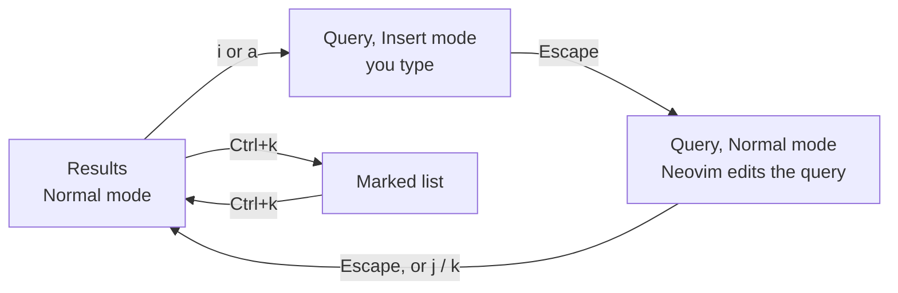

# Keys

fff is driven by Vim-style keys, and every one of them can be changed. This
page explains the two editing modes, where keys apply, how to change them,
and lists the defaults.

## Two modes

Every text field in fff, the query included, is a real embedded Neovim. It
runs with no configuration or plugins of yours, so it behaves the same
everywhere. Like Vim, it has modes:

- **Normal mode**: letters are commands. `j` moves down, `l` goes into a
  folder, `x` moves a file to the trash. fff starts in Normal mode.
- **Insert mode**: letters are text, typed into the query. `i` or `a`
  starts typing; Escape goes back to Normal mode.

The query box's title shows the mode, and its border takes the mode's color
(Visual, Replace and the others work too, as in Neovim). `fff pick`,
`fff seek` and a list piped in start in Insert mode, since you usually want
to type first; so do prompts made for typing, such as a new file's name.

While typing, keys that move or act need Alt or Ctrl, since plain letters
are text: Alt+j / Alt+k move the highlight, Alt+h / Alt+l go up and into
folders. Keys that aren't text, such as Enter, Tab, the arrows and the
function keys, work in both modes.

## The focus

The **focus** is what keys act on. There are three places it can be:

- **the results**, where it is when fff starts;
- **the query** above them;
- **the marked list**, beside them.

The one without the focus is drawn dimmed. They connect like this:



So: `i` to type, Escape to stop typing, Escape again (or `j`) to get back
to the results. Shift+Tab goes straight between the two, even while
typing; Tab from the results goes up into the query. Ctrl+k goes into the marked list and back. A click on a
row gives the results the focus too.

**Why the query in Normal mode matters.** With the query focused, most
letters are Neovim's, so you can edit your query with Vim's motions:
`0`, `w`, `cw`, `x`, `u` (undo), `p` (paste) and so on. Only `j`, `k`,
`-`, `+`, `q` and `gc` keep their fff meaning there. That's why `x` or `u` sometimes edit
the query instead of trashing or undoing: press Escape to give the results
the focus. Keys that aren't text (Enter, Tab, arrows, Alt and Ctrl keys)
still act on the results from the query.

## Where a key applies

Everything a key can do is a **function** with a name, such as
`go_to_parent` or `trash`. A function works only where it makes sense:
`print_marks` only where fff answers with paths, `restore` only in the
trash.

Each key, in turn, applies in a **context**, made of four things:

| Part | Values |
| --- | --- |
| mode | Insert, Normal |
| program | `roam`, `window`, `pick`, `seek`, `piped` (paths from stdin), and the file dialogs `explorer-open`, `explorer-open-multiple`, `explorer-folder`, `explorer-folder-multiple`, `explorer-save` |
| focus | `query`, `results`, `marks` |
| highlight | what's highlighted: `dir`, `file` or `none` (nothing listed) |

A key does exactly one thing in each context, but can do different things
in different ones. Enter is the best example:

| Where | Enter |
| --- | --- |
| `fff roam`, on a file | Opens it and leaves (`open_and_quit`) |
| `fff roam`, on a folder | Nothing; `l` goes in |
| `fff pick`, on anything | Prints the marks and the highlighted path (`print_highlighted_and_marks`) |
| `fff pick`, nothing listed | Prints the folder you're in (`print_here`) |
| `fff seek` | Leaves into the file's folder (`quit_into_highlighted`) |
| `fff window` or a dialog, on a folder | Goes into it (`go_to_highlighted`) |

Most keys don't need this much care: by default, keys typed as text (`x`,
`h`, `gs`…) apply in the results and the marked list, and other keys
(Enter, Ctrl+c, F1…) everywhere. When you change a key, you choose where
it applies, and fff refuses two functions on one key where their contexts
meet.

## The Keys screen (F1)

**F1** replaces the results with a list of every function that works where
you are, with its keys in Insert and Normal mode and a description. Ctrl+a
shows every function, wherever it works.

- **Search** by typing: names, descriptions and key names all match
  (`trash`, `hidden`, `Ctrl+k`).
- **Tab** switches to the **Keys** view, with one row per key: the key, the
  function, the mode and where it applies. In Normal mode, `r` then a key
  searches for that key, handy for keys you can't type into a query.
- **F1** again closes the screen.

To change keys, the same three keys work at every level: **Space** goes a
level deeper, **Enter** is done, **Escape** goes back.

1. **Space on a function** opens its keys, one row per key and context.
   - `n` adds a key: press it (several keys for a sequence such as `gx`;
     Backspace takes one back), then Enter.
   - `R` replaces the highlighted key with the next one you press.
   - `d` deletes the highlighted key; `D` restores the function's default
     keys, after asking.
2. **Space on a key** opens where it applies, as checklists: a column each
   for the mode, the programs, the focuses and the highlights. Tab moves
   between columns, `j`/`k` within one, Space ticks or unticks. The key
   applies wherever a tick in every column meets. Values crossed out with
   `×` can't apply there (the function doesn't work in that program, say).
3. **When a key clashes** with another function's, the sheet shows where.
   Untick until nothing clashes, or press `u` to keep the key only where
   it's free, or `t` to take it from the other function there.
4. **Enter** saves your changes: they apply at once and are written to
   `keys.toml`. Escape (or F1) drops them.

fff won't save keys that would lock you in: something must always open the
Keys screen and leave fff, and something must leave the marked list and the
query. The status line says why when it refuses.

## `keys.toml`

The Keys screen writes your keys to `keys.toml`, beside your configuration
file (usually `~/.config/fff/keys.toml`). You can also edit it by hand; it
holds only what you changed.

```toml
[normal]
quit = "Q"                                  # Q quits instead of q
toggle_hidden = ["g.", "zh"]                # two keys for one function
clear_marks = "<C-x>"                       # a key for a function without one
toggle_preview_wrap = "none"                # no key at all

[insert]
highlight_next = ["<M-j>", "<C-n>"]         # Ctrl+n moves down while typing too
highlight_previous = ["<M-k>", "<C-p>"]
```

- The `[normal]` and `[insert]` tables hold each mode's keys.
- Each entry **replaces** a function's keys in that mode, so list the
  defaults you want to keep. Functions you don't name keep their defaults.
- A value is one key, a list of keys, or `"none"` for no key.
- A key you bind wins over a default one where they clash: with
  `quit = "Q"` alone, `q` is no longer `quit`, so it goes to Neovim.

**Choosing where.** A key can be a table that says where it applies, with
any of `program`, `focus` and `highlight`, each a list of the values
[above](#where-a-key-applies). Left out, a part means everywhere:

```toml
[normal]
# x trashes from the marked list too, not only from the results.
trash = [{ keys = "x", focus = ["results", "marks"] }]

# Enter goes into folders in fff roam as well, as it does in fff window.
go_to_highlighted = [
  { keys = "l", focus = ["results", "marks"] },
  { keys = "<CR>", program = ["roam", "window", "explorer-open", "explorer-open-multiple", "explorer-folder", "explorer-folder-multiple"], focus = ["query", "results"], highlight = ["dir"] },
]
```

A key you bind without a `focus` also applies in the query, ahead of
Neovim's own meaning of it. That's what you want for keys like `<C-x>`,
but not for letters: give letters `focus = ["results", "marks"]` so that
you can still edit the query with them.

**Key names** follow Vim's notation:

| Write | For |
| --- | --- |
| `x`, `G`, `gg`, `g!`, `+` | Those keys, typed in order (`G` is Shift+g) |
| `<CR>` `<Esc>` `<Tab>` `<BS>` `<Del>` `<Insert>` `<Space>` | Enter, Escape, Tab, Backspace, Delete, Insert, Space |
| `<Up>` `<Down>` `<Left>` `<Right>` `<Home>` `<End>` `<PageUp>` `<PageDown>` | Those keys |
| `<F1>`, `<F2>`, … | Function keys |
| `<C-x>` `<M-x>` `<S-CR>` | Ctrl+x, Alt+x, Shift+Enter; combine them as in `<C-M-x>` |
| `<C-S-P>` | Ctrl+Shift+p: with Ctrl, a capital needs `S-` too |
| `<lt>` | `<` |
| `<#>` `<M-#>` `<C-#>` | Any digit, alone or with Alt or Ctrl, for the functions that take a row number or a depth |

A sequence can't be the start of another in the same context (`g` and
`gg`), since fff doesn't wait for a timeout. A mistake in the file makes
fff start with the default keys and say so; `fff setup --check-config`
shows what's wrong. [`keys.example.toml`](keys.example.toml) has more
examples.

## Default keys

Normal mode, with the results focused, unless noted. In Insert mode, the
keys marked *Alt* use Alt with the same letter (Alt+j, Alt+h…), and keys
that aren't letters (Enter, Tab, arrows, Ctrl and F-keys) work the same.

**Moving**

| Key | Function | Does |
| --- | --- | --- |
| `j` / `k` (*Alt*) | `highlight_next` / `highlight_previous` | Next / previous row |
| `J` / `K` | `highlight_next_page` / `highlight_previous_page` | A page down / up |
| `gg` / `G` | `highlight_first` / `highlight_last` | First / last row |
| `j` / `k` in the query | `highlight_first` / `highlight_last` | Down into the results, at the first / last row |
| `1`…`9` | `highlight_row` | Highlight that numbered row |
| Alt+`1`…`9`, Alt+`0` | `go_to_row` | Go to that numbered row / the last, as `l` does (in `fff seek`, only highlight it) |
| `l` (*Alt*) | `go_to_highlighted` | Into a folder, or to a file's folder |
| `h` (*Alt*) | `go_to_parent` | Up to the parent folder |
| `/` | `go_to_path` | Go to a typed folder |
| Ctrl+o / Ctrl+i | `go_to_older_jump` / `go_to_newer_jump` | Back / forward through visited folders |
| Up / Down | `go_to_next_tab` / `go_to_previous_tab` | Next / previous tab |
| Ctrl+Tab | `go_to_next_tab` | Next tab (not in `fff seek`) |
| `gt` | `go_to_trash` | Open the trash |
| `gw` | `show_workspaces` | Workspaces |

**Opening and leaving**

| Key | Function | Does |
| --- | --- | --- |
| Enter | (depends on the program; see [above](#where-a-key-applies)) | Open, print or choose |
| Shift+Enter | `print_highlighted` | Print only the highlighted path (`fff pick`, dialogs) |
| Ctrl+Enter | `print_marks` | Print only the marks (`fff pick`, dialogs for several) |
| `L` | `open_in_background` | Open the file, staying in fff |
| Ctrl+`1`…`9`, Ctrl+`0` | `open_row`, `print_row_and_marks`, `quit_into_row` | Enter on that row: open its file and leave (`fff roam`, `fff window`), print it and the marks (`fff pick`), leave into its folder (`fff seek`) |
| `e` | `edit_files` | Edit in `$EDITOR`, then come back |
| `gx` / `gX` | `run` / `run_and_quit` | Run a program on the files, then come back / in fff's place |
| `!` | `quit_here`, `print_here`, `save_here` | Leave into, print, or save in the folder you're in |
| `g!` | `quit_into_highlighted` | Leave into the highlighted folder (`fff roam`, `fff seek`) |
| `q` | `quit` | Leave without choosing anything |
| Ctrl+c | `cancel` | Leave at once, from anywhere |
| Ctrl+s | `save_here`, `print_here` | Save here (save dialog) or choose this folder (folder dialogs), also while typing |
| — | `open_in_terminal` | Open the files in this terminal, then come back |

**Marks**

| Key | Function | Does |
| --- | --- | --- |
| Space | `toggle_mark` | Mark or unmark, and move on |
| `m` / `M` | `mark_all` / `invert_marks` | Mark everything listed / invert |
| Ctrl+m | `clear_marks` | Clear every mark |
| Ctrl+k | `toggle_marked_list` | Into the marked list, and back |

**Searching**

| Key | Function | Does |
| --- | --- | --- |
| `i`, `a` | (Neovim) | Start typing in the query |
| Tab | `switch_query` | Switch between the names and contents queries (from the query) |
| Escape | `clear_query` | Clear the query (in the results) |
| Escape in the query | `toggle_query_focus` | Give the results the focus |
| Tab in the results | `toggle_query_focus` | Give the query the focus |
| Shift+Tab | `toggle_query_focus` | Give the query or the results the focus, also while typing |
| `+` / `-` | `search_deeper` / `search_shallower` | One level deeper / shallower |
| Ctrl+Alt+`1`…`9` | `search_to_depth` | Search to that depth |
| `g.` | `toggle_hidden` | Hidden entries |
| `gd` / `gD` | `toggle_directories` / `toggle_files` | Hide folders / hide files |
| `gF` / `gf` | `edit_filters` / `toggle_filters` | Edit / toggle the file filters |
| `gE` / `ge` | `edit_exclusions` / `toggle_exclusions` | Edit / toggle the exclusions |
| F5 | `rescan` | Rescan from disk |

**View**

| Key | Function | Does |
| --- | --- | --- |
| `gs` | `show_sorting` | Sort by name, size, date… |
| `gl` | `toggle_labels` | Label rows by name (while only files are listed) or by path |
| `gpp` / `gpw` | `toggle_preview` / `toggle_preview_wrap` | Show the preview / wrap its lines |
| PageDown / PageUp | `scroll_preview_down` / `scroll_preview_up` | Scroll the preview |
| `gP` | `show_palettes` | Choose a color palette |
| — | `reload_palette` | Go back to the configuration's palette |

**Files** (in the results only; see [file operations](OPERATIONS.md))

| Key | Function | Does |
| --- | --- | --- |
| `p` / `v` / `s` | `copy_marked` / `move_marked` / `link_marked` | Copy / move / link the marks here |
| `x` / `X` | `trash` / `delete` | Trash / delete permanently |
| `u` | `undo` | Undo the last operation |
| `r` | `rename` | Rename the listed files in a buffer |
| `n` | `create` | New file or folder |
| `E` | `extract` | Extract archives |
| `R` | `restore` | Restore from the trash |
| Ctrl+j | `toggle_job_list` | Into the jobs list, and back |

**Session**

| Key | Function | Does |
| --- | --- | --- |
| F1 | `show_keys` | The Keys screen |
| F2 | `show_session` | Session details |
| `:` | (fixed) | List what works here, and run it by name |
| `gc` | `edit_config` | Edit the configuration, then apply it |
| `gm` | `switch_program` | Go on as `fff roam`, `pick` or `seek` |

A few keys are fixed and can't be rebound: `i` and `a` (start typing), `:`
(the command list), Escape in Insert mode, and the keys inside choosers,
prompts and confirmation windows (Enter, Escape, `j`/`k`, Tab).

## Editing text

All of Neovim's editing works in fff's fields: motions, operators, counts,
registers, undo, `:s/old/new/`. A few things to know:

- **One-line prompts** (a new name, the go-to prompt, the command for
  `gx`): Enter applies and Escape (from Normal mode) cancels.
- **Buffers** (filters, exclusions, the rename list) have several lines.
  Write and close with `ZZ` (or `:wq`) to apply, `ZQ` (or `:q!`) to
  discard. Escape stays in the buffer, as in Neovim.
- **`:`** in the results' query doesn't open Neovim's command line: it
  lists fff's functions that work there, to run one by name.
- Pasting into a one-line field turns line breaks into spaces.
- `gU`, `g~` and other `g` commands of Neovim still work in the query,
  except those fff uses (`gg`, `gc`, `gs`…).

## Terminals

Some keys need a terminal that reports them distinctly: Shift+Enter,
Ctrl+Enter, Ctrl+Tab, Ctrl+digits and Ctrl+m. fff asks for the kitty keyboard
protocol, which kitty, foot, WezTerm, Ghostty, Alacritty and iTerm2 support
among others. In a terminal without it, bind those functions to other keys.
Ctrl+i likewise needs the terminal to tell it apart from Tab.
